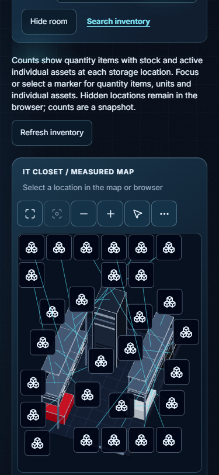
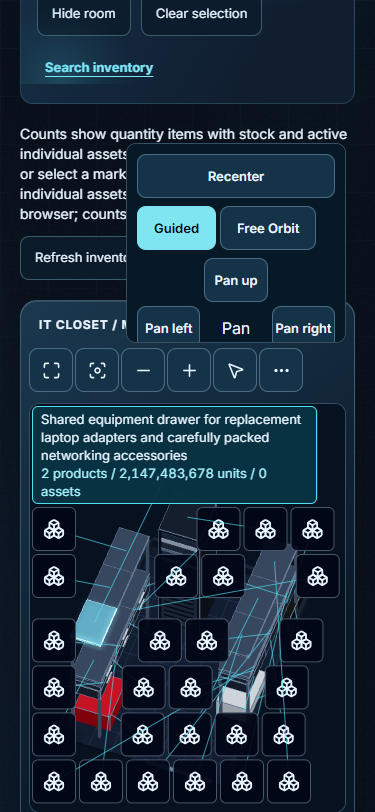

# PR 56 room-label evidence captions

These captures show different datasets and interface states; they are not a matched before/after reproduction pair.

**Initial 375 px reference.** The room view is in its initial fit/closed state. This is an overall initial reference, not the failed long-label stress capture or a matched failure baseline.

**Canonical long-stock/full-name stress capture (7149).** At a 375 px viewport, the selected label measures 285 × 98 px and its full text occupies 267 × 90 px; the full count and full text are visible with More open. This is the captured canonical stress PASS. The associated single layout observation was 8.9 ms; it is not an FPS result or a general performance benchmark.

The baseline unit test failed before the fix, but these two images use different datasets and states and do not establish paired visual causality. The application source is byte-equivalent between 7149 and aaf; that does not make this evidence a capture of a future final SHA.
